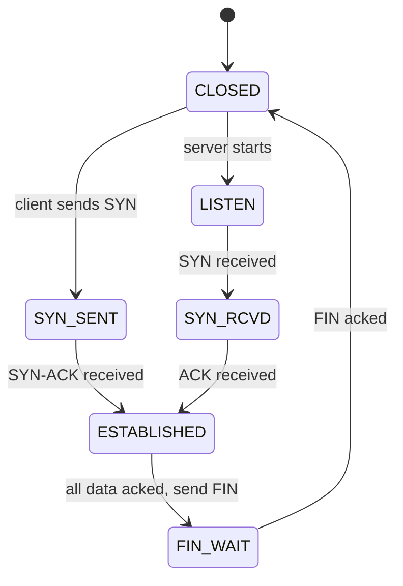

# LossLens design document

## 1. Goal
A reliable transport over UDP with pluggable congestion control. Packet numbers are never reused, so every ACK maps to exactly one transmission (this fixes the false-RTT problem seen in the Phase 0 echo test).

## 2. Packet header (fixed, 37 bytes)

| Field | Size | Purpose |
|---|---|---|
| version | 1 B | Protocol version (starts at 1) |
| type | 1 B | 0 DATA, 1 ACK, 2 SYN, 3 SYN-ACK, 4 FIN, 5 RST |
| flags | 1 B | bit0 ECT, bit1 CE (set by emulator), bit2 ECE, rest reserved |
| connection ID | 4 B | Identifies the connection |
| packet number | 8 B | Strictly increasing, never reused, retransmissions get a new number |
| stream offset | 8 B | Byte position of the payload in the file |
| send timestamp | 8 B | Microseconds since sender start, used for RTT |
| payload length | 2 B | Bytes of payload that follow |
| CRC32 | 4 B | Integrity check over header and payload |

Maximum payload (MSS): 1200 bytes. All numbers are big-endian.

## 3. ACK frame (payload of a type 1 packet)
- largest acknowledged packet number
- ACK delay (microseconds the receiver waited before sending the ACK)
- SACK ranges: list of (start, end) packet-number ranges received
- cumulative CE counter: total CE-marked packets seen so far (AccECN style)

## 4. Connection states

## 5. Loss detection rules (RFC 9002 style)
- Packet threshold: a packet is lost when a packet at least 3 numbers higher has been acknowledged
- Time threshold: a packet is lost when it is older than 9/8 of max(srtt, latest RTT) and a later packet was acknowledged
- Probe timeout: if nothing is acknowledged for a while, send a probe packet (covers tail loss)
- RTT: smoothed RTT and variance (RFC 6298 style), plus windowed minimum RTT. Queueing delay = RTT - minRTT

## 6. Congestion controller events
Every controller (Reno, CUBIC, BBRv3-style, LossLens) receives the same events and exposes the same outputs, so comparisons are fair.

Inputs:
- on_packet_sent(bytes)
- on_ack(acked_bytes, rtt, ce_count)
- on_loss(lost_bytes)

Outputs:
- cwnd (bytes allowed in flight)
- pacing_rate (bytes per second)

## 7. Decisions log
- Controller is chosen at start-up with a command-line flag (--cc reno | cubic | bbr | losslens)
- Clock and network I/O are kept separate from protocol logic so a simulator can replace them later
- Header uses a CE flag in our own header because real IP-ECN bits are unreliable on Windows sockets (documented limitation)
- Encryption is out of scope (Stretch)
## 8. ACK frame wire layout (final)
largest acked 8 B, ack delay 4 B (microseconds), CE counter 4 B, range count 2 B, then 16 B per SACK range (start 8 B, end 8 B). All big-endian.
